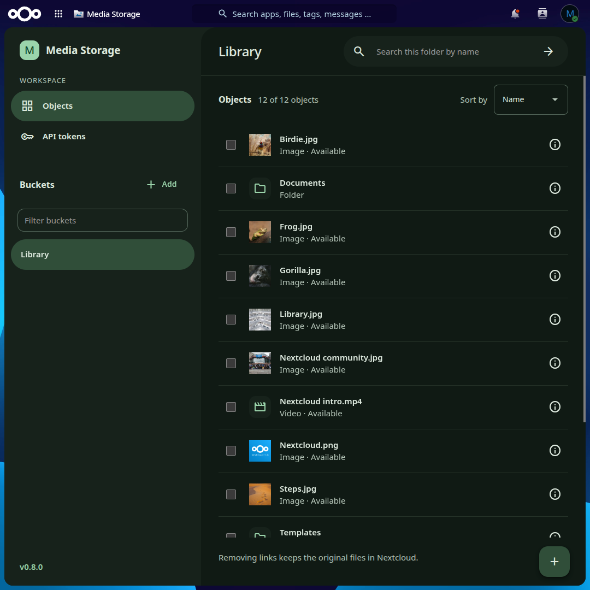
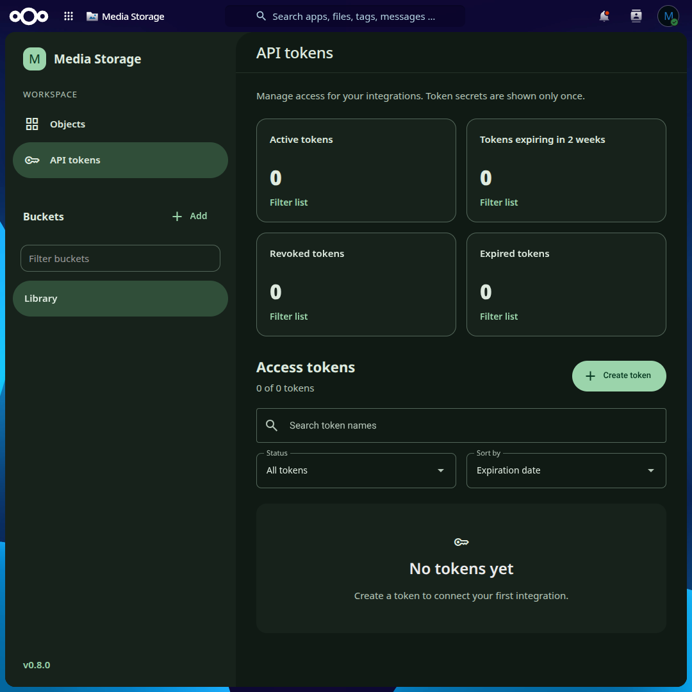
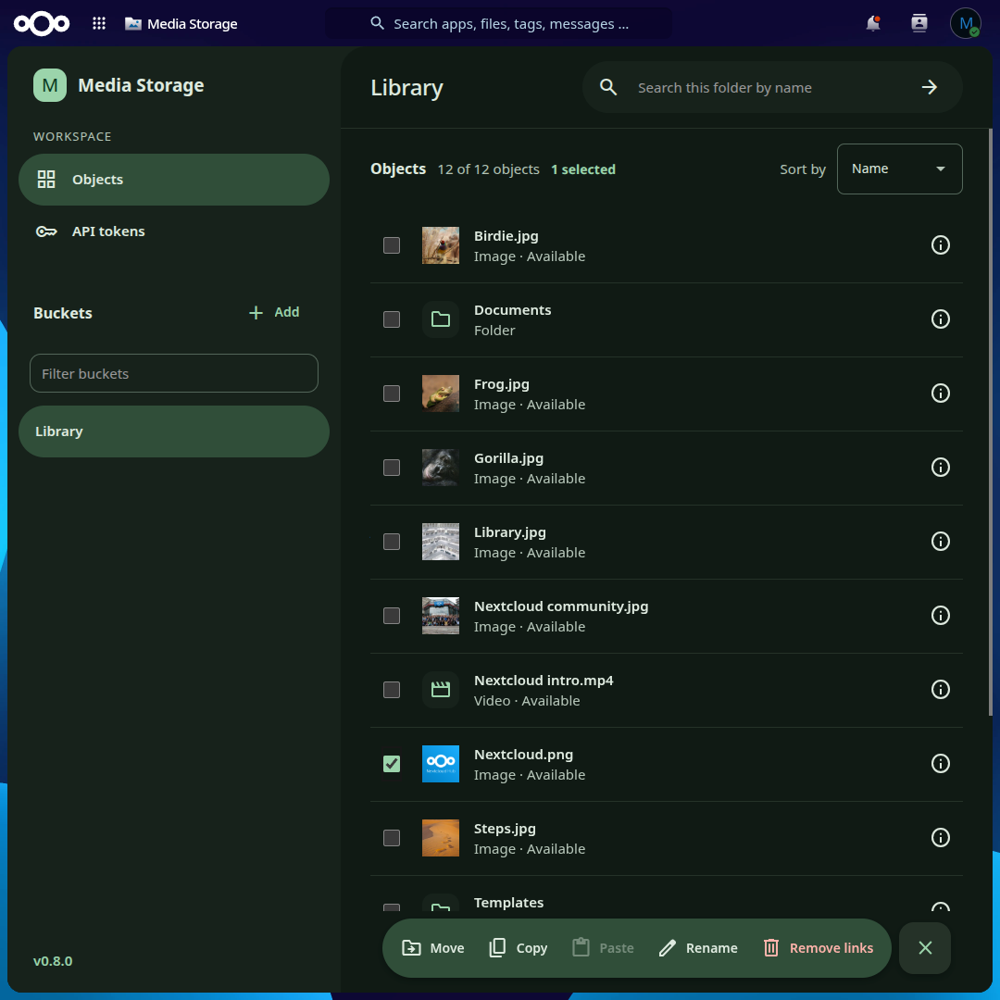
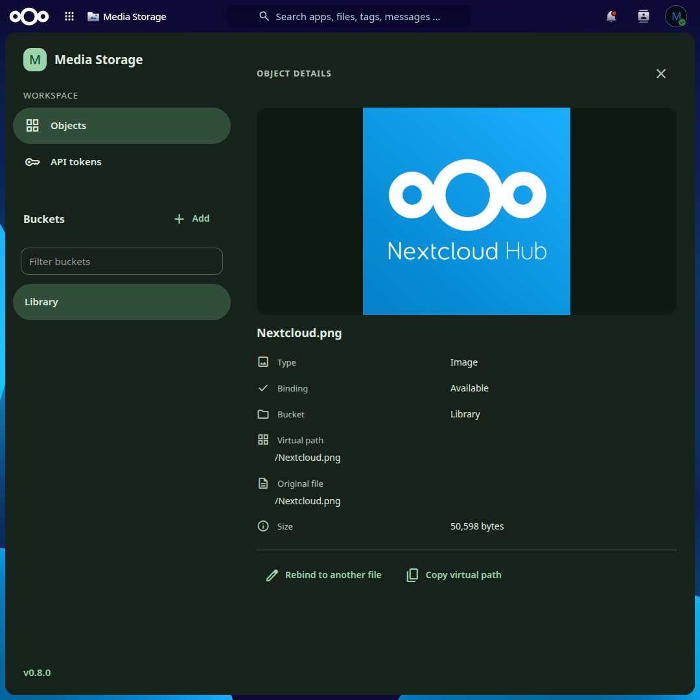
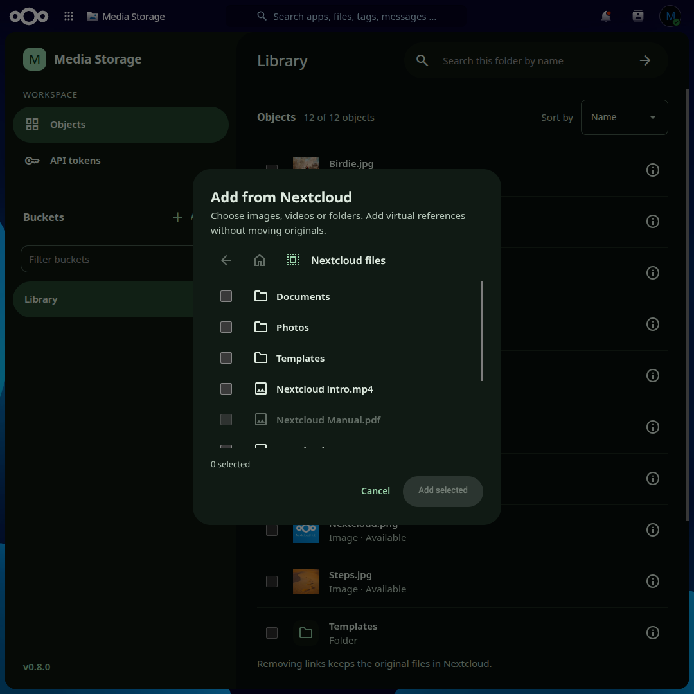

# Nextcloud Media Storage

Native Nextcloud app foundation (`mediastorage`) for private virtual media organization, using Nextcloud filesystem, database, and session authentication.

## Screenshots

### Object explorer

Virtual buckets and folders reference existing Nextcloud images and videos. Removing a reference keeps the original file.



### API tokens

Scoped tokens for server-to-server integrations, with active, expiring, revoked and expired summaries. Token secrets are shown only once.



### Selection toolbar

Select objects to move, copy, paste, rename or remove their links.



### Object details

Preview an object and inspect its type, binding, bucket, virtual path, original file and size. Rebind it to another file or copy its virtual path.



### Add from Nextcloud

Choose images, videos or folders from Nextcloud files and add them as virtual references without moving the originals.



**Status:** Media Storage 0.8.0 implements account-isolated virtual buckets, reference management, daily uploads, previews, scoped API tokens, temporary media access, conditional/range streaming and native abuse controls. UI-01–16 feature implementation is complete. Installed 0.8.0 streaming acceptance passed 76 access HTTP, 31 streaming/policy HTTP and 19 native-player browser checks, plus 130 API regression checks. Release acceptance and remaining manual gates are tracked in [US-MS-08](docs/agile/user-stories/US-MS-08.md); an unsigned artifact is not a published release.

The recorded primary target is Nextcloud 34.0.4 / PHP 8.4.26 / Snap MySQL. Separate release-container results are recorded in the compatibility document; do not infer other database/version support from schema generation alone.

Build an unsigned deterministic archive with `npm run package` and validate it with `python3 tests/package_release.py` (Python 3 required). GitLab CI repeats that build and can upload the archive to MinIO; set the credentials as CI/CD variables described in the [developer guide](docs/wiki/development/development.md). Install the exact archive through the target Nextcloud app manager/occ, quiesce requests during replacement and restart/reload web workers as needed to invalidate opcode caches. Back up and restore the database, configuration and original files together; copying older app code is not a schema rollback. See the [installation guide](docs/manual/installation-and-configuration.md).

Start with the [documentation index](docs/index.md), [Sprint 01](docs/agile/sprint-backlogs/sprint-01.md), [installation guide](docs/manual/installation-and-configuration.md), and [tests](tests/README.md).

## Local checks on this Snap test host

```bash
sh scripts/php-snap.sh tests/run.php
sh scripts/php-snap.sh tests/tokens.php
sh scripts/php-snap.sh tests/schema.php
sh scripts/php-snap.sh tests/explorer.php
npm ci --ignore-scripts
npm run build
npm test
```

These commands use the bundled PHP CLI and installed Nextcloud public interfaces. They do not run within Snap confinement or initialize a Nextcloud database.

## Author and licence

Author: **Kongphai Wutthichaiya**. This project is licensed under **AGPL-3.0-or-later**; see [LICENSE](LICENSE).

The owner selected this licence to align with Nextcloud. Nextcloud's [licensing notice](https://github.com/nextcloud/server/blob/master/COPYING-README) uses AGPL version 3 or later unless otherwise noted. Third-party components retain their own notices; calling an API does not by itself establish one universal plugin licensing rule.

`appinfo/info.xml` contains the configured author and licence and is validated against the installed Nextcloud schema. The template and configurator are retained for explicit metadata changes.

## Historical Phase 2 verification

Version 0.2.0 was deployed at this checkpoint. The incremental migration ran during disable/enable, and 70 live HTTP checks passed against Nextcloud 34.0.4 / Snap MySQL, including token lifecycle/scopes, real filesystem bindings, CSRF, concurrent hierarchy mutations and user-ID recreation isolation. Local checks: 69 existing checks, 61 new token/scope/lifecycle checks and SQLite populated-schema upgrade checks. See [Sprint 02](docs/agile/sprint-backlogs/sprint-02.md).

The explorer UI, upload transport, binary media delivery and signed URLs are not implemented by this change.
